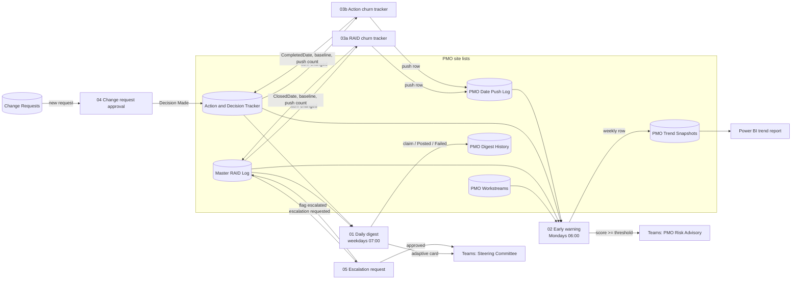
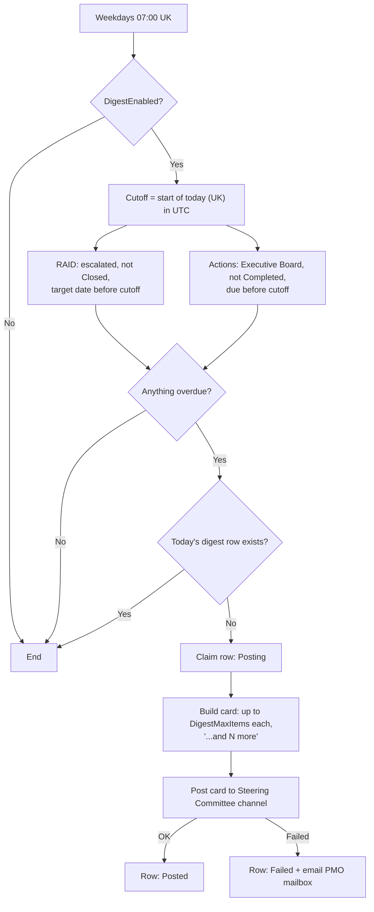
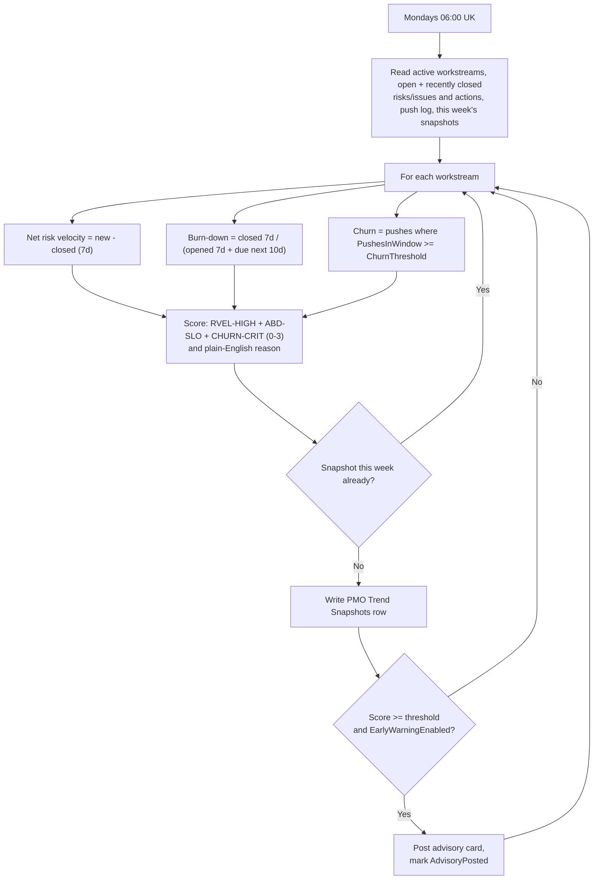
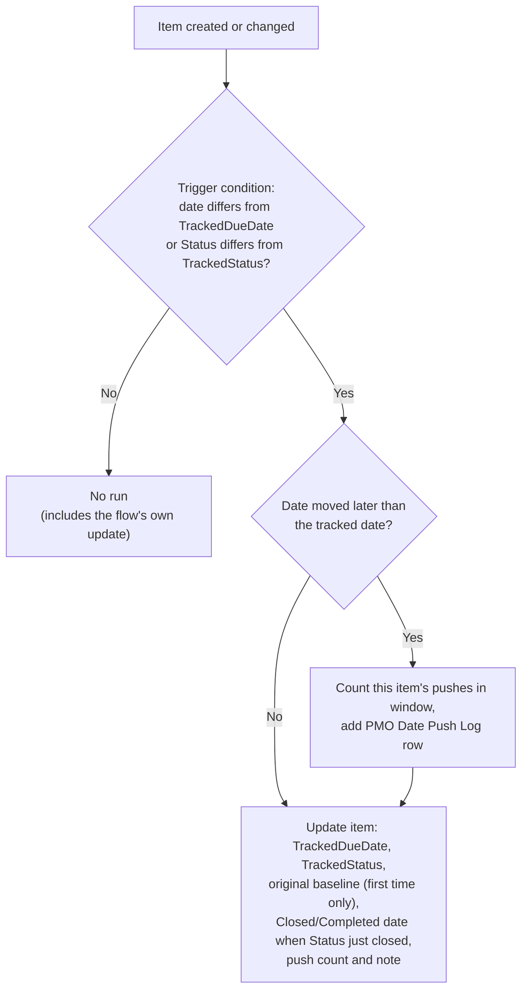
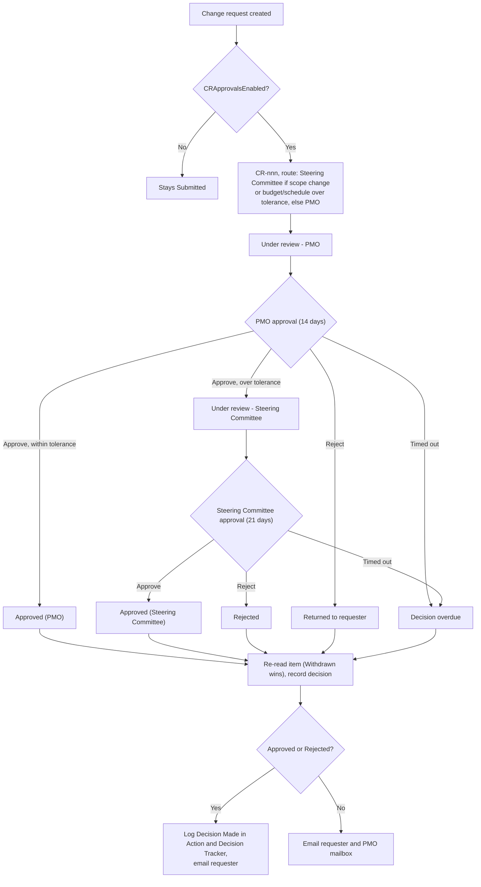
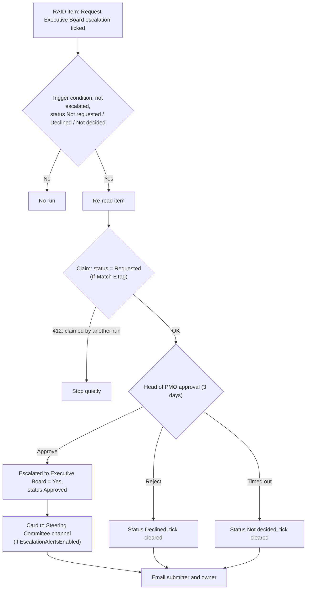

# Enterprise PMO flows: process diagrams

Rendered by GitHub. One diagram per flow, then how the lists connect.

## How the pieces fit

## 01 Daily executive overdue digest

## 02 Predictive early warning

## 03a / 03b Date churn trackers

## 04 Change request approval

## 05 Risk and issue escalation request

