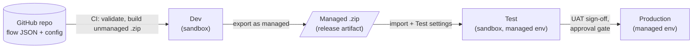

# Power Platform deployment plan

How the two flow solutions move from this repository into production and
stay supported in BAU:

| Solution | Flows | Connectors |
|----------|-------|------------|
| **SharePoint Governance (BAU)**, `solutions/SharePointGovernance` | 6 | SharePoint, Office 365 Outlook, Approvals, HTTP with Microsoft Entra ID, Azure Automation |
| **SharePoint News and Notices**, `solutions/SharePointNews` | 4 | SharePoint, Office 365 Outlook, Microsoft Teams |

Today each solution is built as an **unmanaged** .zip and imported by hand.
That's fine for a first test, but not for production. Unmanaged flows can be
edited in place, so production can drift from what's in the repo, and they
can't be cleanly upgraded or rolled back.

## Target model



- **The source of truth is the repo.** Nobody edits flows in Test or
  Production. A fix is made in the repo, then rebuilt and redeployed.
- **Dev** holds the unmanaged solution. It's the only place flows are
  opened in the designer, and the only place a managed package is exported
  from.
- **Test and Production** receive the **managed** package only, so their
  flows can't be edited there, and an upgrade or rollback is a single import.
- **Per-environment values** (site URLs, mailboxes, connections) live in a
  deployment settings file per environment, not in the package.

## Environments

| Environment | Type | Purpose | Data |
|-------------|------|---------|------|
| SPO Flows - Dev | Sandbox | Import CI builds, export managed packages, troubleshoot | Test governance site, test news sites, test recipients |
| SPO Flows - Test | Sandbox, Managed Environment | UAT against test sites | As Dev, with real (test) groups and mailboxes |
| SPO Flows - Production | Production, Managed Environment | Live | Live governance and news sites |

Use dedicated environments, not the default environment: DLP, ownership and
solution history stay separate from personal flows. If the BAU environment
you have already imported into is meant to become Production, follow
[Moving the existing import](#moving-the-existing-import).

**DLP policy** (applied to all three): put SharePoint, Office 365 Outlook,
Approvals, Microsoft Teams, HTTP with Microsoft Entra ID and Azure Automation
in the **Business** group, and block HTTP (plain), custom connectors and
everything else not needed.

## Identities

| Identity | Used for | Notes |
|----------|----------|-------|
| **Deployment app registration** (service principal) | GitHub Actions: import, export and settings | Added as an *application user* in each environment with the *System Customizer* role. Client secret or certificate stored as GitHub secrets |
| **Governance flow account** (licensed user, `svc-spo-governance@…`) | Owns the governance connections: SharePoint, Office 365 Outlook, Approvals, HTTP with Microsoft Entra ID, Azure Automation | Owned by the SharePoint service owner |
| **News flow account** (licensed user, `svc-spo-news@…`) | Owns the news connections: SharePoint, Office 365 Outlook, Microsoft Teams | Owned by the news support owner (Nigel Bell) |
| **Backup owner** | Second owner of every flow and connection reference | A named person in the support team, one per solution |

There are **two flow accounts, one per solution** (decided 23 October 2026,
subject to InfoSec agreeing the exceptions). Each account reaches only what
its own flows need, so a problem with one can't affect the other solution.
SharePoint, Outlook, Teams and Approvals need a user connection, so a
service principal can't run the flows. Everyone else (publishers, approvers,
requesters) keeps using their own named account; readers never see the flow
accounts, because email goes out from the Communications mailbox (Send As)
and Teams posts appear as Flow bot.

**Each flow account needs a governance exception.** PID v3.1 prohibits
shared and service accounts in SharePoint, and BLD-008 (page 14) allows
service accounts only with "owner, purpose, credential and review evidence".
Raise one entry per account in the Governance Exception Register before
Test:

| | `svc-spo-governance` | `svc-spo-news` |
|---|---|---|
| Purpose | Running the governance flows (01 to 06) | Running the news flows (C1, C2, C3a, C3b) |
| Owner | SharePoint service owner | News support owner (Nigel Bell) |
| SharePoint rights | Governance site: Edit on the lists it writes, Read elsewhere | HPUK News and Other News: Edit on Site Pages and Delivery Log, Read elsewhere |
| Mail | Sends from its own mailbox only | Send As on the Communications mailbox only |
| Other | Azure Automation job operator on the governance Automation account | Member of the port Teams channels it posts to |

Both entries also record:

- MFA, with sign-in from named locations or Conditional Access
- no interactive mailbox use
- credentials held in the IT password vault
- a 12-month expiry and review

**Licences.** HTTP with Microsoft Entra ID and Azure Automation are
**premium** connectors (check against your current licensing). The
governance account needs **Power Automate Premium**, or assign a **Power
Automate Process** licence to the governance flows. The news flows use only
standard connectors, so the news account needs only a Microsoft 365 licence
with a mailbox.

## Deployment settings

Generate a settings template once per solution from the built package, then
keep one filled-in copy per environment in the repo:

```
pac solution create-settings --solution-zip dist/SharePointGovernance_1_0_0_0.zip --settings-file deploy/governance.test.json
```

```
deploy/
  governance.test.json   governance.prod.json
  news.test.json         news.prod.json
```

Each file holds two things:

- **EnvironmentVariables**: site URLs, role mailboxes, Automation account
  IDs, the review interval. None of these are secrets, so they're fine in git.
- **ConnectionReferences**: the connection ID per connector in that
  environment. Create each connection once as that solution's flow account, then
  copy its ID from *Data → Connections* (it's in the URL).

The values differ only between Test and Production, so a pull request shows
exactly what changes in Production.

## Pipeline

Extend the existing `governance-flows.yml` and `news-flows.yml` workflows,
using the `microsoft/powerplatform-actions` steps already used in
`power-platform-ci.yml`.

| Stage | Runs when | Steps |
|-------|-----------|-------|
| **Validate** | Every PR | `validate_flows.py`, `build_solution.py` (already in place) |
| **Dev** | Merge to `main` | Import the unmanaged .zip into Dev. Bump the version from the run number (`1.0.<run>.0`). `export-solution --managed`. Upload the managed .zip as the release artifact |
| **Test** | Automatically after Dev | `import-solution` with the managed .zip and `deploy/<solution>.test.json`, `activate-plugins: true` (turns flows on), then run the smoke tests |
| **Production** | Manual: GitHub environment `prod` with **required reviewers** (SharePoint service owner and IT Operations) | Import the same managed artifact with `deploy/<solution>.prod.json` |

Production imports the **exact artifact** that passed Test. It is never rebuilt.

**GitHub secrets** (per GitHub environment): `PP_APP_ID`, `PP_CLIENT_SECRET`,
`PP_TENANT_ID`, and `PP_ENV_URL` for Dev, Test and Prod.

## Rollout

| Step | What | Owner | Done when |
|------|------|-------|-----------|
| 1 | Create the three environments, the DLP policy, and the deployment app user in each | IT / Power Platform admin | Environments listed, app user has System Customizer |
| 2 | Create the two flow accounts; governance exception for each; licence them (Premium or Process for governance, Microsoft 365 for news) | SharePoint service owner, news support owner, InfoSec | Both exceptions recorded with an evidence reference; licences assigned |
| 3 | Create connections as each solution's flow account in Test and Prod; fill in the `deploy/*.json` files | IT | Settings files merged |
| 4 | Add the GitHub environments, secrets and required reviewers, and add the Dev/Test/Prod jobs to both workflows | IT / repo maintainer | A merge to `main` reaches Test unaided |
| 5 | **Governance**: UAT in Test against the test governance site, using the test plan in its README | SharePoint service owner | Each flow passes its quick test; evidence filed |
| 6 | **News**: UAT in Test against test news sites, using the test table in its README, with Chloe, Rachel or Toby sending the urgent tests | Communications, IT | Test table signed off, including publish without approval, unauthorised urgent, partial failure and resend |
| 7 | Production: approve the Prod job for governance, then news. Turn flows on in the README order | Service owner, IT Operations | Flows on; first scheduled runs succeed |
| 8 | Hand over: runbook, owner list, alert routing | IT Operations | Support owner confirms |

Steps 1 to 4 are a one-off. After that, each change is a PR, which merges and
deploys to Test automatically, then waits for an approved Production run.

## Operating it

- **Monitoring.** Every flow already emails its failures to the support
  owner. Also turn on Power Automate's *flow failure* email for both
  flow accounts, and review run history weekly for the first month.
- **News deliveries needing a person.** Check the Delivery Log *Needs
  checking* view (rows left Reserved or Reconcile) whenever a failure alert
  arrives, and weekly. The news flows never resend those on their own.
- **Emergency stop for news.** Set the `DispatchEnabled` environment variable
  to No: the roundup and urgent flows stop sending at once, without turning
  any flow off.
- **Connections** are the usual cause of failure: a password change, MFA
  re-prompt or licence removal on a flow account. Include them in each
  account's exception review, and re-authenticate in Production only, under
  *Data → Connections*.
- **Ownership.** Each solution's flow account and its named backup co-own every flow in that solution.
  When the backup leaves, replace them; the flows keep running.
- **Upgrades.** Each release has a higher version number, and Production
  only ever moves forward.
- **Rollback.** Power Platform won't import a lower version over a higher
  one. Instead, revert the change in the repo and release it as a new
  version through the same pipeline. For an urgent stop, turn the affected
  flow off in Production; the next deployment turns it back on.

## Moving the existing import

The governance solution has already been imported **unmanaged**. Before the
first managed release:

1. If that environment will be **Test or Production**, delete the unmanaged
   *SharePoint Governance (BAU)* solution from it. Use **Delete** on the
   solution only: its flows are kept as loose components, and the managed
   import takes them over, because the IDs match.
2. If it is a personal or default environment, leave it, turn its flows
   off, and deploy fresh to the new environments.
3. In both cases, re-enter the connection and environment variable values
   through the settings file, not by hand.

## Open decisions

| Decision | Owner |
|----------|-------|
| Environment names, regions and capacity | Power Platform admin |
| Licensing route for the premium connectors (Premium per user vs Process) | IT / Finance |
| Who approves Production runs | SharePoint service owner, IT Operations |
| Whether Dev is shared or per developer | IT |
