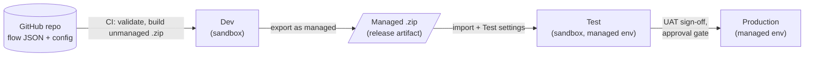

# Power Platform deployment plan

How the two flow solutions move from this repository into production and
stay supported in BAU:

| Solution | Flows | Connectors |
|----------|-------|------------|
| **SharePoint Governance (BAU)**, `solutions/SharePointGovernance` | 6 | SharePoint, Office 365 Outlook, Approvals, HTTP with Microsoft Entra ID, Azure Automation |
| **SharePoint News and Notices**, `solutions/SharePointNews` | 4 | SharePoint, Office 365 Outlook, Microsoft Teams |

Today each solution is built as an **unmanaged** .zip and imported by hand.
That's fine for a first test, but not for production. Unmanaged flows can be
edited in place, so production can drift from what's in the repo, and they
can't be cleanly upgraded or rolled back.

## Target model



- **The source of truth is the repo.** Nobody edits flows in Test or
  Production. A fix is made in the repo, then rebuilt and redeployed.
- **Dev** holds the unmanaged solution. It's the only place flows are
  opened in the designer, and the only place a managed package is exported
  from.
- **Test and Production** receive the **managed** package only, so their
  flows can't be edited there, and an upgrade or rollback is a single import.
- **Per-environment values** (site URLs, mailboxes, connections) live in a
  deployment settings file per environment, not in the package.

## Environments

| Environment | Type | Purpose | Data |
|-------------|------|---------|------|
| SPO Flows - Dev | Sandbox | Import CI builds, export managed packages, troubleshoot | Test governance site, test news sites, test recipients |
| SPO Flows - Test | Sandbox, Managed Environment | UAT against test sites | As Dev, with real (test) groups and mailboxes |
| SPO Flows - Production | Production, Managed Environment | Live | Live governance and news sites |

Use dedicated environments, not the default environment: DLP, ownership and
solution history stay separate from personal flows. If the BAU environment
you have already imported into is meant to become Production, follow
[Moving the existing import](#moving-the-existing-import).

**DLP policy** (applied to all three): put SharePoint, Office 365 Outlook,
Approvals, Microsoft Teams, HTTP with Microsoft Entra ID and Azure Automation
in the **Business** group, and block HTTP (plain), custom connectors and
everything else not needed.

## Identities

PID v4.2 (D-03, guardrail G-01, §12.2) allows **no service, shared or generic
accounts**. Flows run under **named** people; the only non-named identity is
the Azure Automation system-assigned managed identity used by runbooks. This
replaces the two service accounts decided on 23 October 2026.

| Identity | Used for | Notes |
|----------|----------|-------|
| **Governance flow owner** (a named IT Operations administrator in Carl Sharman's team, to name) | Owns the governance connections: SharePoint, Office 365 Outlook, Approvals, HTTP with Microsoft Entra ID, Azure Automation | Their own licensed account (E5). Approval and notice emails come from their mailbox |
| **News flow owner** (Nigel Bell as news support owner, or a named IT Operations administrator) | Owns the news connections: SharePoint, Office 365 Outlook, Microsoft Teams | Their own licensed account, with Send As on the Communications mailbox. Readers see the Communications mailbox and Flow bot, not the owner |
| **Backup owner** (one named person per solution) | Co-owner of every flow and connection reference | Takes over the connections if the owner leaves or is absent |
| **Azure Automation managed identity** | The governance baseline runbook | Sites.Selected grant per site URL (G-04), recorded in the grant register; SharePoint Administrator role for the tenant-level step, as for the RCD runbook (G-03, DEP007) |
| **Deployment app registration** (service principal) | GitHub Actions: import, export and settings | Application user with *System Customizer* in each environment. It never accesses SharePoint content; confirm with InfoSec that it falls outside D-03 |

SharePoint, Outlook, Teams and Approvals need a user connection, so a
service principal can't run the flows. Everyone else (publishers, approvers,
requesters) keeps using their own account.

**What the named owners need**

| | Governance flow owner | News flow owner |
|---|---|---|
| SharePoint rights | IT Enterprise Governance site: Edit on the governance lists; rights to create sites | HPUK News and Other News: Edit on Site Pages and Delivery Log, Read elsewhere |
| Mail | Sends from their own mailbox | Send As on the Communications mailbox |
| Other | Azure Automation job operator on the governance Automation account | Member of the port Teams channels the flows post to |
| Licence | E5: premium connectors confirmed (PID v4.2 §5.8) | E5 or any licence with a mailbox |

**Leavers and absence.** The named owner and the backup co-own every flow.
When either changes role or leaves, reassign the connections and ownership to
the next named person before their account is disabled (PID v4.2 §12.2), and
record it in the handover pack. Never move them to a shared account.

## Deployment settings

Generate a settings template once per solution from the built package, then
keep one filled-in copy per environment in the repo:

```
pac solution create-settings --solution-zip dist/SharePointGovernance_1_0_0_0.zip --settings-file deploy/governance.test.json
```

```
deploy/
  governance.test.json   governance.prod.json
  news.test.json         news.prod.json
```

Each file holds two things:

- **EnvironmentVariables**: site URLs, role mailboxes, Automation account
  IDs, the review interval. None of these are secrets, so they're fine in git.
- **ConnectionReferences**: the connection ID per connector in that
  environment. Create each connection once as that solution's named flow owner, then
  copy its ID from *Data → Connections* (it's in the URL).

The values differ only between Test and Production, so a pull request shows
exactly what changes in Production.

## Pipeline

Extend the existing `governance-flows.yml` and `news-flows.yml` workflows,
using the `microsoft/powerplatform-actions` steps already used in
`power-platform-ci.yml`.

| Stage | Runs when | Steps |
|-------|-----------|-------|
| **Validate** | Every PR | `validate_flows.py`, `build_solution.py` (already in place) |
| **Dev** | Merge to `main` | Import the unmanaged .zip into Dev. Bump the version from the run number (`1.0.<run>.0`). `export-solution --managed`. Upload the managed .zip as the release artifact |
| **Test** | Automatically after Dev | `import-solution` with the managed .zip and `deploy/<solution>.test.json`, `activate-plugins: true` (turns flows on), then run the smoke tests |
| **Production** | Manual: GitHub environment `prod` with **required reviewers** (SharePoint service owner and IT Operations) | Import the same managed artifact with `deploy/<solution>.prod.json` |

Production imports the **exact artifact** that passed Test. It is never rebuilt.

**GitHub secrets** (per GitHub environment): `PP_APP_ID`, `PP_CLIENT_SECRET`,
`PP_TENANT_ID`, and `PP_ENV_URL` for Dev, Test and Prod.

## Rollout

| Step | What | Owner | Done when |
|------|------|-------|-----------|
| 1 | Create the three environments, the DLP policy, and the deployment app user in each | IT / Power Platform admin | Environments listed, app user has System Customizer |
| 2 | Name the flow owner and backup for each solution; switch on the Automation account's managed identity and give it the rights in Identities | IT Operations (Carl Sharman), InfoSec | Owners named in the handover pack; managed identity rights recorded in the grant register |
| 3 | Create connections as each solution's named flow owner in Test and Prod; fill in the `deploy/*.json` files | IT | Settings files merged |
| 4 | Add the GitHub environments, secrets and required reviewers, and add the Dev/Test/Prod jobs to both workflows | IT / repo maintainer | A merge to `main` reaches Test unaided |
| 5 | **Governance**: UAT in Test against the test governance site, using the test plan in its README | SharePoint service owner | Each flow passes its quick test; evidence filed |
| 6 | **News**: UAT in Test against test news sites, using the test table in its README, with Chloe, Rachel or Toby sending the urgent tests | Communications, IT | Test table signed off, including publish without approval, unauthorised urgent, partial failure and resend |
| 7 | Production: approve the Prod job for governance, then news. Turn flows on in the README order | Service owner, IT Operations | Flows on; first scheduled runs succeed |
| 8 | Hand over: runbook, owner list, alert routing | IT Operations | Support owner confirms |

Steps 1 to 4 are a one-off. After that, each change is a PR, which merges and
deploys to Test automatically, then waits for an approved Production run.

## Operating it

- **Monitoring.** Every flow already emails its failures to the support
  owner. Also turn on Power Automate's *flow failure* email for both
  named flow owners, and review run history weekly for the first month.
  For the runbook, check the Automation jobs log daily: success is the
  `###RESULT###` object saying Success, not the flow run (G-10).
- **News deliveries needing a person.** Check the Delivery Log *Needs
  checking* view (rows left Reserved or Reconcile) whenever a failure alert
  arrives, and weekly. The news flows never resend those on their own.
- **Emergency stop for news.** Set the `DispatchEnabled` environment variable
  to No: the roundup and urgent flows stop sending at once, without turning
  any flow off.
- **Connections** are the usual cause of failure: a password change, MFA
  re-prompt, role change or leaver on a named flow owner. Reassign before
  the account changes, and re-authenticate in Production only, under
  *Data → Connections*.
- **Ownership.** Each solution's named flow owner and backup co-own every flow in that solution.
  When either leaves, reassign to the next named person first; never to a shared account.
- **Upgrades.** Each release has a higher version number, and Production
  only ever moves forward.
- **Rollback.** Power Platform won't import a lower version over a higher
  one. Instead, revert the change in the repo and release it as a new
  version through the same pipeline. For an urgent stop, turn the affected
  flow off in Production; the next deployment turns it back on.

## Moving the existing import

The governance solution has already been imported **unmanaged**. Before the
first managed release:

1. If that environment will be **Test or Production**, delete the unmanaged
   *SharePoint Governance (BAU)* solution from it. Use **Delete** on the
   solution only: its flows are kept as loose components, and the managed
   import takes them over, because the IDs match.
2. If it is a personal or default environment, leave it, turn its flows
   off, and deploy fresh to the new environments.
3. In both cases, re-enter the connection and environment variable values
   through the settings file, not by hand.

## Open decisions

| Decision | Owner |
|----------|-------|
| Environment names, regions and capacity | Power Platform admin |
| Licensing route for the premium connectors (Premium per user vs Process) | IT / Finance |
| Who approves Production runs | SharePoint service owner, IT Operations |
| Whether Dev is shared or per developer | IT |
