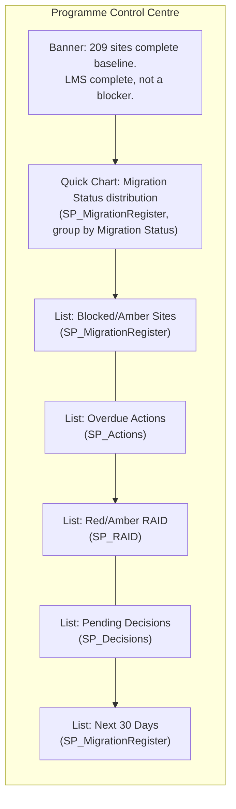
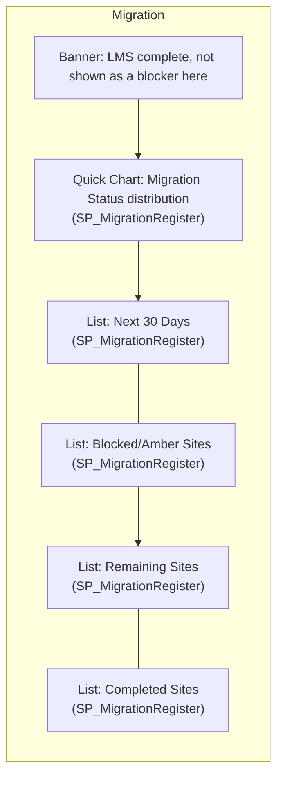
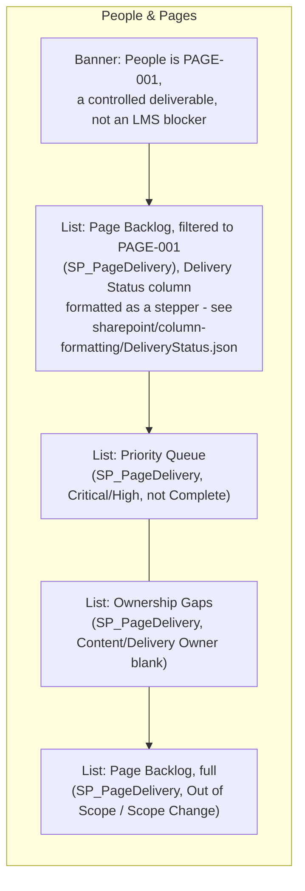
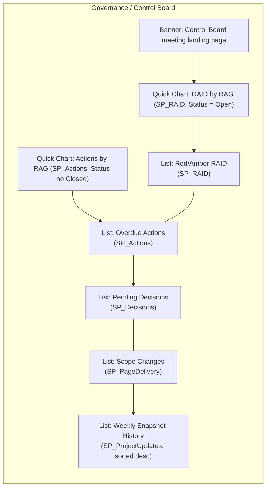

# Control Centre page layout — native web parts only

One diagram per modern SharePoint page. Every box is a native out-of-the-box
web part (List web part, Quick Chart web part, or a Text/banner web part) -
nothing here is custom code. "List (view: X)" means a List web part bound to
that list, showing the named filtered view; "Quick Chart" means grouped/counted
from that list's own data, added manually through the page editor (see
[`../README.md`](../README.md) for the exact setup and why it isn't scripted).

## Why four separate exception widgets, not one merged table

Both the List web part and the Quick Chart web part bind to **one list at a
time** - there's no native way to blend SP_RAID + SP_Actions +
SP_MigrationRegister + SP_Decisions into a single table or chart. Tier 1
accepts that and stacks the equivalent native widgets side by side instead,
as shown above. A true merged view would need a Power Automate flow copying
matching rows into one consolidated list - not built here; see
[`../README.md`](../README.md#tier-2) if that becomes worth the extra
plumbing.
