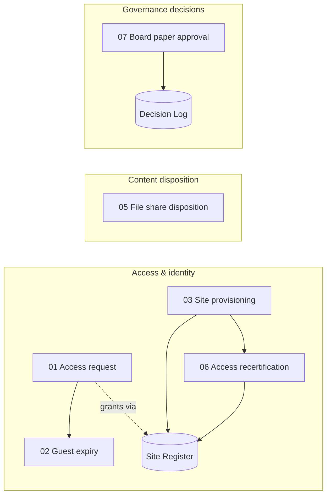
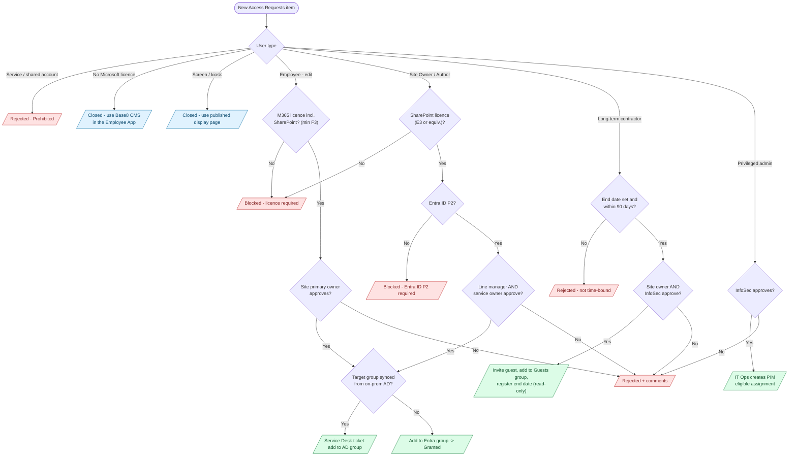
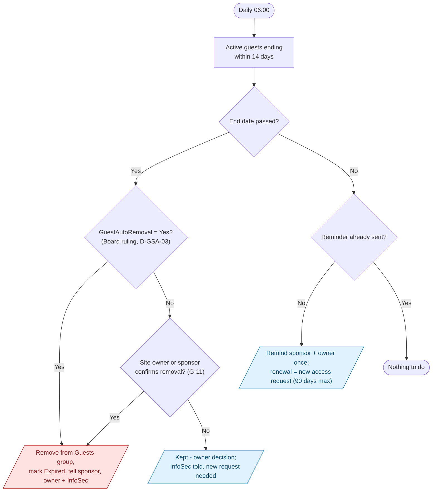
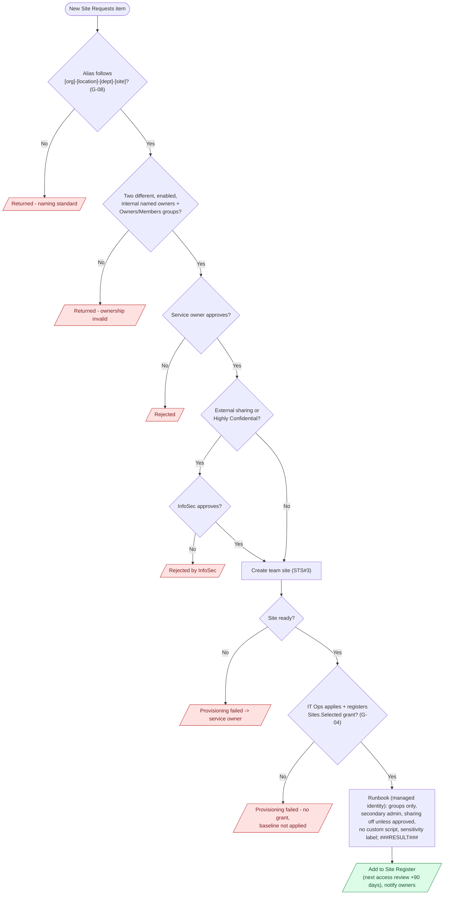
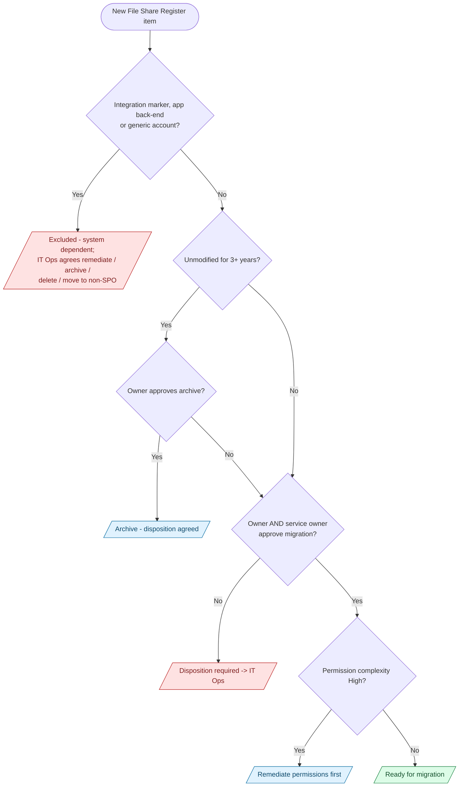
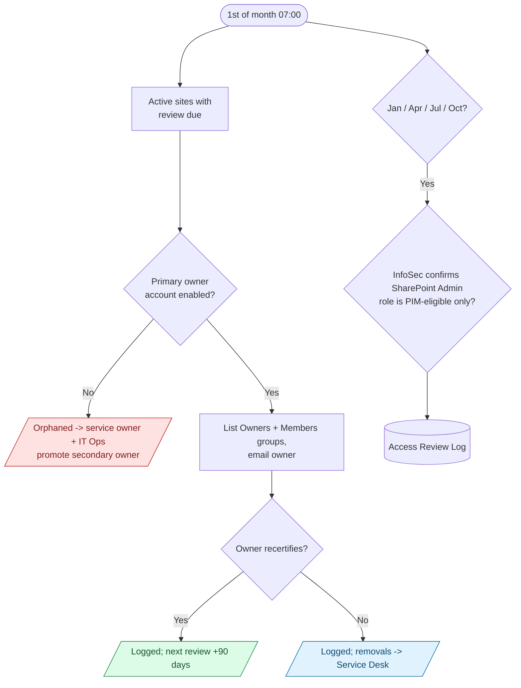
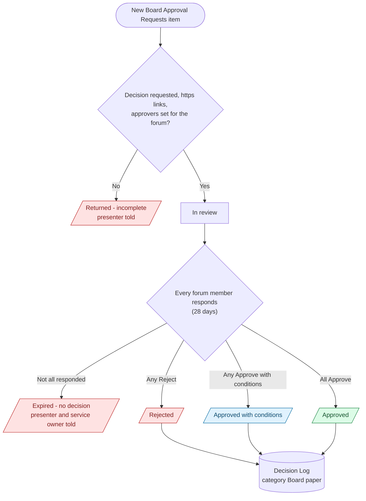

# SharePoint governance flows — process diagrams

One diagram per flow in `../powerautomate/flows/`. Flow 04 (InfoPath
triage) was retired on 25 October 2026 (PID v4.2: InfoPath retired, triage by
the Criticality Decision Tree). Each diagram shows the
decision the flow enforces and who approves it. Green ends are grants or
approvals, red ends are blocks or rejections. Role names map to people in
[`../README.md`](../README.md#roles).

## Overview

## 01 — Access request (Access Method Decision Table)

## 02 — Guest access expiry (daily)

## 03 — Site provisioning

## 05 — File share disposition (selective migration)

## 06 — Access recertification (monthly; 90-day cycle per site)

## 07 — Board paper approval (TAB or BAU governance forum)

