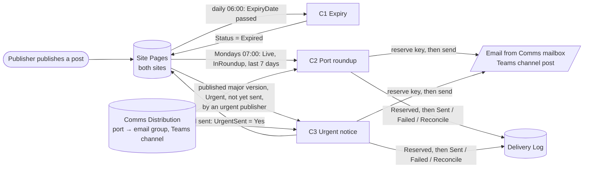

# SharePoint News and Notices

The build for **HPUK SharePoint Online News Design v1.2**: two communication
sites (HPUK News and Other News) aggregated on the intranet home, with
expiry, a weekly port roundup and urgent notices automated in Power Automate.
It uses standard modern pages only, with no SPFx.

| Part | What it is |
|------|-----------|
| [`sharepoint/list-schema.json`](sharepoint/list-schema.json) | Every list and column on both sites. The single source for provisioning and flow validation |
| [`provisioning/Provision-NewsSites.ps1`](provisioning/Provision-NewsSites.ps1) | PnP script that applies the schema, views, permissions (with page approval off) and the Publisher Guide page to both sites |
| [`provisioning/Set-NewsRetention.ps1`](provisioning/Set-NewsRetention.ps1) | Purview retention policy: 7 years on both sites |
| [`pages/Publisher-Guide.html`](pages/Publisher-Guide.html) | Content of Publisher-Guide.aspx on HPUK News |
| [`powerautomate/flows/`](powerautomate/flows) | C1 expiry, C2 weekly port roundup, C3a/C3b urgent notice (one per site) |
| [`diagrams/news-flows.md`](diagrams/news-flows.md) | Process diagrams for every flow, including the reserve-then-send safeguard |
| [`taxonomy/`](taxonomy) | Department and Category term sets (term-store import files) |
| [`solution-config.json`](solution-config.json) | Solution package settings: environment variables and connection references |

## Design decisions

The design leaves several points open. Most of them change how the build
works, so the build takes a position on each. Each one is easy to reverse
if Communications or IT decide otherwise.

| # | Design v1.2 says | The build does | Why |
|---|------------------|----------------|-----|
| 1 | Port blank means all ports | **Port is required**, with an explicit *All ports* choice | A forgotten Port on an urgent notice would otherwise email every port |
| 2 | A Managers-targeted post must not be emailed to a whole port; either route or exclude it | **Audience-targeted posts are excluded** from the roundup and from urgent broadcasts. C3 logs *Skipped - audience targeted* and tells Communications | Audience targeting is personalisation, not a distribution list. Port routing can't express "managers at Felixstowe" |
| 3 | Dispatch key uses an "agreed publication event" | Key = `urgent\|site\|page ID\|r<NotificationRound>\|port\|channel`. **NotificationRound** is a page column (default 1) | Edits never resend. Communications sends a correction by raising the round and resetting UrgentSent |
| 4 | Don't assume a metadata update leaves the published page unchanged | C1 and C3 update Status and UrgentSent with **ValidateUpdateListItem** (`bNewDocumentUpdate`): no new version, no draft | A normal update leaves a published news page with a pending draft |
| 5 | UrgentSent is not the sole duplicate control | The trigger runs only for **major versions** (`x.0`) with UrgentSent = No, one at a time. Each port and channel is **reserved** in the Delivery Log before sending (see the safeguards below) | Retries send only definite failures; an unknown outcome waits for a person. Setting UrgentSent cannot re-trigger the flow |
| 6 | Expiry boundary to confirm | **ExpiryDate is the last current day.** C1 runs 06:00 UK time and expires dates before today (UK date, so BST is handled) | Matches the design's proposed rule |
| 7 | Frontline route for generic accounts | **Out of this build.** PID v3.1 prohibits shared and generic accounts in SharePoint. Its approved routes are the Employee App (view-only staff) and display-mode pages (screens) | Avoids a design that breaks the access model |
| 8 | Everyone except external users as Visitors, to confirm | **A scoped reader group** is required by the script, and EEEU is never used | The tenant is shared with a peer company |
| 9 | Compare the built-in news digest with C2 | C2 is built, with **InRoundup** and per-port routing that the built-in digest can't do | Pilot both. If the built-in digest is good enough, turn C2 off |
| 10 | Classification and governance of the sites | Request both sites through the **governance Site Requests list** (flow 03), Sensitivity *General*, with named primary and secondary owners | Puts the sites in the Site Register, so they get 90-day access reviews |

### Business decisions (confirmed 22 October 2026)

| Decision | Confirmed | Where it's applied |
|----------|-----------|--------------------|
| Ports | **Felixstowe, Harwich, Thamesport** (plus *All ports* on posts) | `list-schema.json`: Port choices on posts and Comms Distribution |
| Who can send urgent notices | **Chloe, Rachel and Toby** | `UrgentPublisherEmails` environment variable. C3 sends only when the post's author or last editor is on the list; anything else is logged as *Skipped - not an urgent publisher* and Communications is told |
| Page approval | **None. Publishers are pre-approved** (changed 23 October 2026; this replaces HR approving every page) | Content approval stays off on Site Pages (the provisioning script turns it off if it was on). A published page is live straight away, and an urgent post by Chloe, Rachel or Toby alerts as soon as it is published. Membership of the publisher groups is the control, so keep them to trained, named publishers |
| Retention | **7 years** from creation, on both sites | `provisioning/Set-NewsRetention.ps1`: a Purview retention policy. Nothing is deleted automatically at the end unless the records owner asks for `-DeleteAfterRetention` |
| Support owner | **Nigel Bell** | `SupportOwnerEmail` environment variable: receives all flow failure alerts |
| Urgent notices for staff without a licence | **Updated separately in each area** (26 October 2026). About 1,500 operational staff use the Base8 CMS in the Employee App and receive no email or Teams alert | Outside these flows: C3 alerts licensed staff by email and Teams only. Each area posts its own urgent notices for unlicensed staff through its local route (Base8 CMS, noticeboards, supervisor briefings). Nothing in the build changes |
| Images and video | Pictures added in the page (banner image and Image or Image gallery web parts) with alt text; video uploaded to a **News Videos** library on each site and shown with the File and media web part, playing through Stream. No external video embeds (G-06). Emails, Teams alerts and the roundup carry text and a link only | `list-schema.json` and `Provision-NewsSites.ps1`: the News Videos library (major versions, site permissions, a Captions checked column). Publisher Guide: Images and video section |
| Strategy themes | **Option A** (26 October 2026): an optional **Strategy theme** label with Our People, Our Business, Our Environment and One TEAM, separate from Department and Category. A post can carry more than one | `taxonomy/TermSet-StrategyTheme.csv` and a multi-value `StrategyTheme` column on Site Pages. Theme sections on the intranet home filter on it. C2 groups the Monday roundup by theme when `RoundupGroupByTheme` = Yes (default No). Communications supplies each theme's wording, including the One TEAM principles |
| Departments and categories | **13 departments and 16 categories, confirmed for UAT** (24 October 2026). Department is who owns a post; Category is what it is about | [`taxonomy/`](taxonomy): `TermSet-Department.csv` and `TermSet-Category.csv` for the term store, and `terms.json` with each term's definition and examples. The Safety section filters on Category **Health and Safety**. Communications gives final sign-off after UAT; changes after that are made in the term store |

### Safeguards added after the independent review (24 October 2026)

An independent review of the design (with a Power Apps source package)
raised four points this build has adopted. Its other proposals were not
adopted: a Power Apps publisher console (the design excludes a custom app;
Quick Links on the Publisher Guide page do the same job), extra approval
flags on each post (publishers are pre-approved), and a blank Port meaning
all ports (decision 1).

| Safeguard | How it works |
|-----------|--------------|
| **Reserve before sending** | The Delivery Log Title (the dispatch key) is unique and indexed. Before each email or Teams post the flow writes a *Reserved* row, and sends only if that succeeds. The send has no automatic retry. The row then becomes *Sent*; *Failed* if the provider definitely rejected it (a 4xx other than 408/429); or *Reconcile* if the outcome is unknown (a timeout, 5xx or throttling). Only *Failed* rows are ever retried. A person checks *Reconcile* rows (the **Needs checking** view) with the recipient and sets *Failed* to allow a resend |
| **Master switches, off by default** | `DispatchEnabled` = No: C2 and C3 send nothing (runs show as Cancelled). `ExpiryWritesEnabled` = No: C1 changes nothing and emails the support owner the pages it would have expired. Turn each on only after it has been proven, and set `DispatchEnabled` back to No to stop all sending at once |
| **Urgent go-live date** | `UrgentGoLiveDate`: C3 ignores posts first published before it, so editing an old or migrated post never sends an alert. Set it once at go-live and don't move it |
| **Fixed roundup week** | C2 covers Monday 00:00 to Monday 00:00 UK time, the week before the run. A late or repeated run covers the same posts and reuses the same dispatch keys, so nothing is sent twice |

## How it works



## Deploying

1. **IT foundations.** Request both sites through the governance Site
   Requests list. Associate both with the intranet hub, and designate HPUK
   News as an organisation news site. Create these Entra security groups:
   - HPUK readers (scoped to the HPUK population)
   - HPUK News publishers
   - Other News publishers
   - news configuration maintainers

   Also create the Department, Category and Strategy theme term sets by
   importing `taxonomy/TermSet-Department.csv`, `taxonomy/TermSet-Category.csv`
   and `taxonomy/TermSet-StrategyTheme.csv` into the Communications term group (SharePoint admin centre → Term store
   → Communications → Import term set), and a shared mailbox
   for sending, with Send As for the **named news flow owner** (no service
   or shared account, D-03; see the
   [deployment plan](../POWER-PLATFORM-DEPLOYMENT.md#identities)).
2. **Provision.** Run `provisioning/Provision-NewsSites.ps1` with the two site
   URLs, the group object IDs and the flow
   owner's UPN. Add `-CreateTemplates` to build the page templates *HPUK
   News post* and *Other News post* (header, then Summary, Main content,
   Action required and deadline, Attachments, Contact; the Summary hint
   reminds publishers to fill in Page details before publishing); run it once per
   site, and use `-RefreshTemplates` to rebuild them after a layout change.
   Afterwards open each template, add a banner image and republish. Then have a Purview compliance admin run
   `provisioning/Set-NewsRetention.ps1` for the 7-year retention.
3. **Manual site settings.** These have no supported cmdlet:
   - Site Pages → *Settings → Audience targeting* → **On**, on both sites.
   - Page templates, only if you didn't use `-CreateTemplates`: create
     *HPUK News post* and *Other News post* by hand (+ New → News post →
     lay out the sections → *Save as template*) in the order summary,
     main content, action required and deadline, attachments, contact.
   - Home pages: set up the News web parts as listed below.
4. **Comms Distribution.** Add one row per port, with its email group, Team ID
   and Channel ID. For a company-wide roundup, add a row with Port **All
   ports** (for example an all-HPUK list or a corporate Teams channel): it
   receives every post in the Monday roundup but never an urgent alert, since
   each port already gets All ports alerts. Anyone in both a port list and the
   company-wide list gets two roundups. Set `Enabled` = No until each destination has been tested.
5. **Import the flows.** Build the package and import it as in
   [the governance README](../SharePointGovernance/README.md#importing):
   ```
   python solutions/SharePointGovernance/tools/build_solution.py --root solutions/SharePointNews
   ```
   It needs three connections (SharePoint, Office 365 Outlook, Microsoft
   Teams), signed in as the named news flow owner, and ten environment variables,
   including Nigel's address (`SupportOwnerEmail`) and the urgent publishers'
   addresses, separated by semicolons (`UrgentPublisherEmails`). None is
   mandatory at import: after importing, open the solution → **Environment
   variables** and set the six whose description starts "Set after import".
   Leave `DispatchEnabled` and `ExpiryWritesEnabled` at No and
   `UrgentGoLiveDate` at its default for now.
   CI also builds it: download the artifact *SharePointNews-solution*.
6. Turn on **C1** first, then **C3a/C3b**, then **C2**. With the switches
   off nothing is sent or changed yet.
7. **Switch on, in this order:**
   1. After a few C1 dry-run emails list the right pages, and expiry has
      been checked on a test page, set `ExpiryWritesEnabled` to Yes.
   2. Set `UrgentGoLiveDate` to the go-live date and time in UTC, for
      example `2026-11-02T00:00:00Z`.
   3. When each Comms Distribution row has been tested (`Enabled` = Yes),
      set `DispatchEnabled` to Yes.

### News web part settings

| Page | Web part | Source | Filter | Layout |
|------|----------|--------|--------|--------|
| HPUK News home | News | This site | Page properties: Status = Live | Top story |
| HPUK News home | News (Safety) | This site | Status = Live **and** Category = Health and Safety | List |
| Other News home | News | This site | Status = Live | Side-by-side |
| Intranet home | News (main) | HPUK News | Status = Live; audience targeting on | Top story |
| Intranet home | News (secondary) | Other News | Status = Live; audience targeting on | List, lower on the page |
| Intranet home (optional) | News, one per theme: Our People, Our Business, Our Environment, One TEAM | HPUK News and Other News | Status = Live **and** Strategy theme = that theme | Side-by-side or carousel |

If the News web part can't filter on the managed metadata Category in your
tenant, use a Category view of Site Pages in a Highlighted content web part
for the Safety section instead.

## Testing

Use test sites, test groups and safe test recipients first: the PoC set-up
is not the production permission model.

| Test | Pass condition |
|------|----------------|
| Expiry | A post with yesterday's ExpiryDate shows Expired after the 06:00 run. A blank date stays Live. The page version doesn't change and no draft appears |
| Urgent, happy path | One email and one Teams post per matching port. Delivery Log has one *Sent* row per port and channel. UrgentSent = Yes |
| Urgent, edit | Editing and republishing a sent urgent post sends nothing |
| Urgent, correction | Round + 1 and UrgentSent = No, then republish. Exactly one new alert per destination |
| Urgent, partial failure | Disable one Teams channel. The other sends succeed, the failure is logged as Failed, support is alerted and UrgentSent stays No. Resubmitting the run sends only the failed one |
| Unknown outcome | Force a timeout or 5xx on one send (e.g. an unreachable mailbox). The row is logged as Reconcile and appears in *Needs checking*; resubmitting the run does **not** resend it until the row is set to Failed |
| Concurrent runs | Resubmit the same urgent run twice at once. Each destination is sent once; the second reservation fails on the unique key and nothing is sent |
| Switches off | With `DispatchEnabled` = No, publishing an urgent post and running C2 send nothing (runs show Cancelled). With `ExpiryWritesEnabled` = No, C1 emails a dry-run list and changes no page |
| Go-live date | Editing and republishing an urgent post first published before `UrgentGoLiveDate` sends nothing |
| No approval | A publisher's page is visible to readers as soon as it is published, with no approval request. An urgent post by an urgent publisher alerts once, on publish |
| Unauthorised urgent | An urgent post by a publisher not on the urgent list sends nothing, logs *Skipped - not an urgent publisher* and tells Communications once |
| Audience-targeted urgent | Nothing is broadcast. A *Skipped - audience targeted* row is logged and Communications is emailed once |
| All ports | A post tagged *All ports* reaches every enabled row |
| Company-wide roundup | An enabled Comms Distribution row with Port All ports gets one digest listing every port's posts. An urgent post for All ports does **not** go to that row |
| Roundup by theme | `RoundupGroupByTheme` = Yes: posts appear under their theme headings (a post with two themes under both), posts with no theme under Other news |
| Roundup | Covers last Monday 00:00 to this Monday 00:00 UK time, for the right ports. A port with no posts gets nothing. A re-run later in the week sends nothing new |
| Daylight saving | Runs in the week the clocks change still fire at 06:00 and 07:00 UK time |
| Reader boundary | Someone outside the HPUK reader group can't open pages or attachments |
| Retention | Deleting a test page leaves a copy in the Preservation Hold library (after the policy has distributed) |
