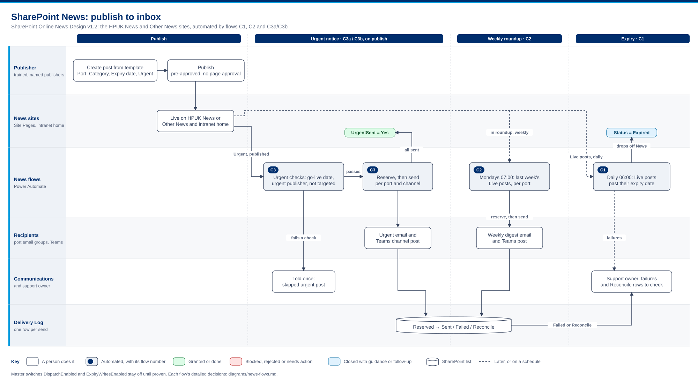
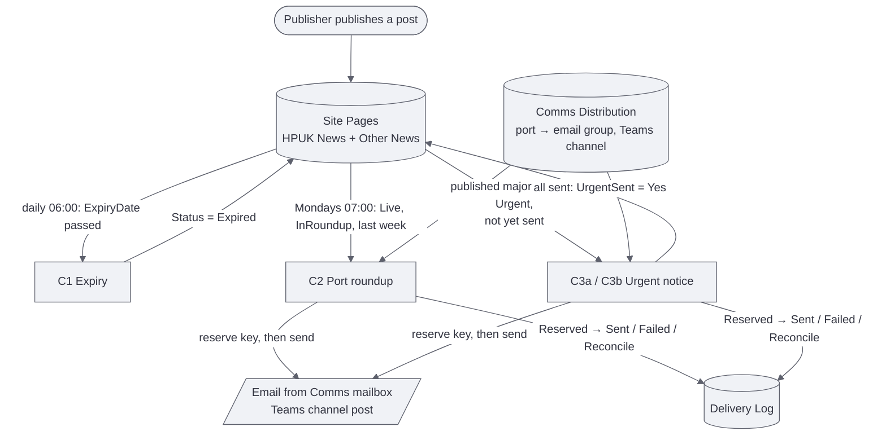
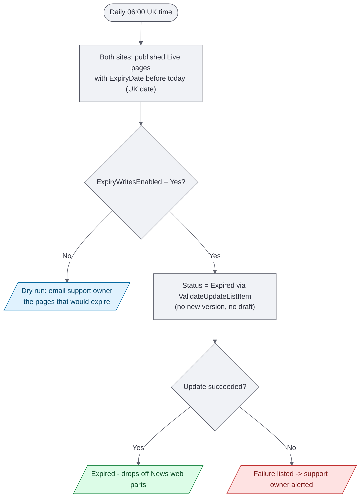
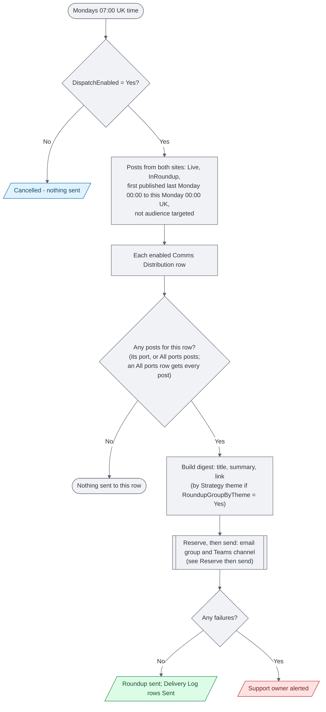
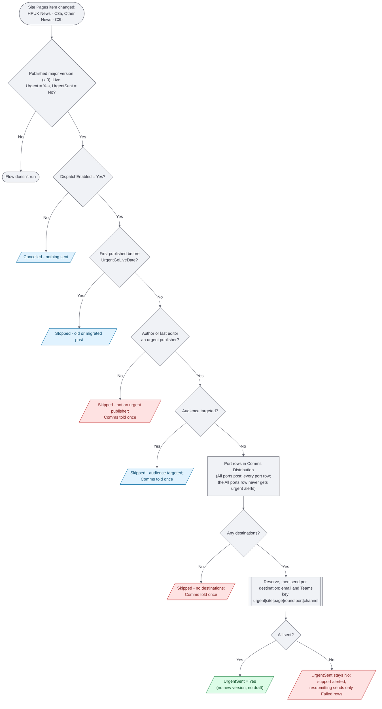
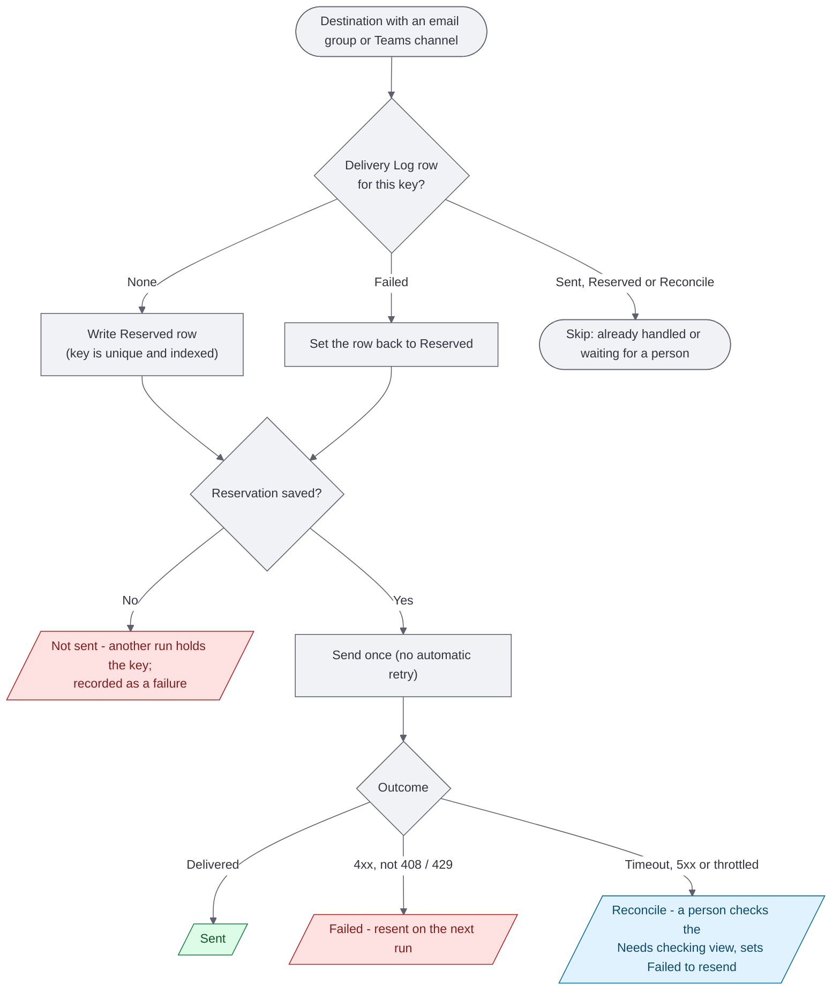

# SharePoint News flows — process diagrams

One diagram per flow in `../powerautomate/flows/`; C3a (HPUK News) and C3b
(Other News) are the same flow on different sites. Green ends are
successful outcomes, red ends need someone to act, blue ends are deliberate
stops or follow-ups. The shapes and colours follow the governance diagrams
([`../../SharePointGovernance/diagrams/governance-flows.md`](../../SharePointGovernance/diagrams/governance-flows.md)).
Delivery statuses are the *DeliveryStatus* choices of the Delivery Log in
[`../sharepoint/list-schema.json`](../sharepoint/list-schema.json).

## End to end

Who does what, from request to review. Regenerate with `python solutions/SharePointGovernance/tools/draw_workflows.py`.

## Overview

## C1 — News expiry (daily 06:00 UK)

## C2 — Weekly port roundup (Mondays 07:00 UK)

## C3a / C3b — Urgent notice (on publish)

A correction is sent by raising **NotificationRound** and setting UrgentSent
back to No, then republishing: the new round gives new keys.

## Reserve then send (C2 and C3, per email or Teams destination)

